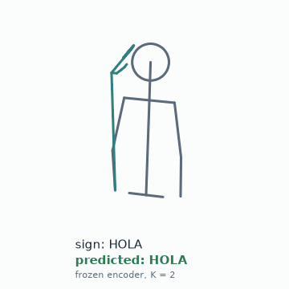
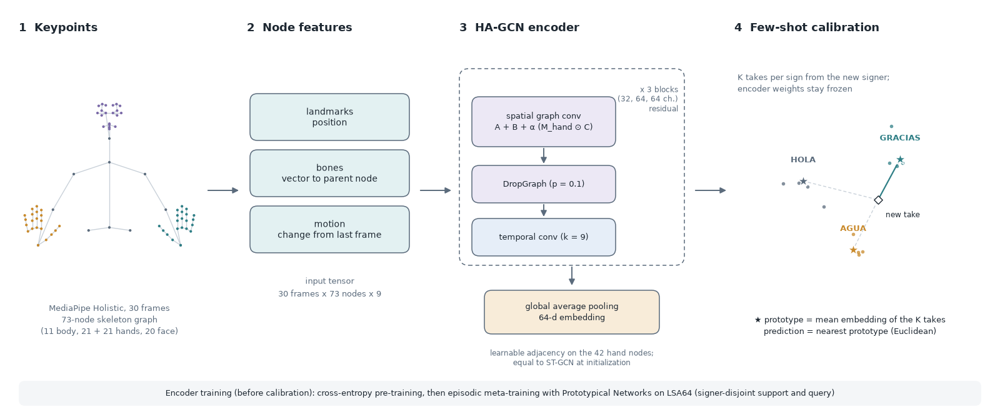

# Few-Shot Peruvian Sign Language Recognition with Hand-Aware Graph Networks

Isolated Peruvian Sign Language (LSP) recognition from pose keypoints, with a hand-aware graph
network and Prototypical-Network calibration to new signers from 1 to 8 examples per sign.

[Project page](https://guisa17.github.io/lsp-stgcn-fewshot/) · Weights (soon) · [Demo](#demo)



## Abstract

Few certified interpreters and almost no automatic tools are available to the Peruvian Deaf
community, which limits its access to healthcare, education and public services. We study isolated
sign recognition for Peruvian Sign Language (LSP) from MediaPipe Holistic keypoints, with a focus on
adapting to new signers from a few examples. An encoder meta-trained with Prototypical Networks on
LSA64 (Argentinian Sign Language) and then kept frozen recognizes 30 LSP signs from a signer it has
never seen with 69.7 to 72.8% accuracy, calibrated with only 1 to 2 takes per sign (chance: 3.3%).
On unseen LSA64 signers, the same calibration reaches 98.8 to 99.5% with 1 to 4 takes per sign. A
linear head fine-tuned on the same takes matches or exceeds Prototypical calibration for 2 or more
takes per sign. Trained directly on our 30-sign, two-signer LSP dataset, the encoder (HA-GCN, a
hand-aware graph network) reaches 98.8% test accuracy (ST-GCN 96.3%, Bi-LSTM 72.8 to 87.7%); this
split shares signers between training and test, so it does not measure generalization to new
signers.

## Method



Each take is 30 frames of MediaPipe Holistic keypoints, mapped to a 73-node skeleton graph (11 body,
21 + 21 hand and 20 face nodes) and normalized per take; every node carries its coordinates, its
bone vector to the parent node and its frame-to-frame motion. HA-GCN alternates spatial graph
convolutions over a partitioned skeleton adjacency with temporal convolutions, and adds a learnable
adjacency term restricted to the hand nodes plus DropGraph regularization; at initialization it is
identical to ST-GCN. For new signers, the encoder is pre-trained and then meta-trained on LSA64 with
signer-disjoint episodes. At calibration time its weights stay frozen: each class prototype is the
mean embedding of the K calibration takes, and a test take is assigned to the nearest prototype.

## Results

All numbers come from the files in [`results/`](results/). The refactored code reproduces them
(see [`results/VERIFICATION.md`](results/VERIFICATION.md)).

**Table 1. LSP, 30 classes, sample-level split.** *Protocol: intra-subject. Train, validation and
test takes are split per class (378 / 81 / 81) and both signers appear in all three sets, so this
table measures vocabulary learning, not generalization to new signers. One seed.*

| Model | Input streams | Params | Test accuracy (%) | Macro F1 (%) |
|---|---|---:|---:|---:|
| Bi-LSTM | landmarks | 193,502 | 72.84 | 71.35 |
| Bi-LSTM | landmarks + bones + motion | 417,758 | 87.65 | 86.43 |
| ST-GCN | landmarks + bones + motion | 109,024 | 96.30 | 96.38 |
| **HA-GCN** | landmarks + bones + motion | 204,949 | **98.77** | **98.86** |

**Table 2. LSA64, 64 classes, unseen signers.** *Protocol: signer-disjoint. For each of 3 seeds, 2 of
the 10 LSA64 signers are held out from meta-training; the encoder is calibrated with K takes per
class of each held-out signer and tested on the rest. Mean +/- std over 60 pooled trials per K, in %.*

| Encoder | Calibration | K = 1 | K = 2 | K = 4 |
|---|---|---:|---:|---:|
| ST-GCN | ProtoNet | 98.0 +/- 1.2 | 99.0 +/- 0.7 | 99.1 +/- 1.0 |
| ST-GCN | Fine-tune-K | 97.8 +/- 1.5 | 98.8 +/- 0.8 | 99.3 +/- 0.9 |
| HA-GCN | ProtoNet | 98.8 +/- 1.0 | 99.4 +/- 0.5 | 99.5 +/- 0.8 |
| HA-GCN | Fine-tune-K | 98.8 +/- 0.8 | 99.5 +/- 0.4 | 99.6 +/- 0.7 |

**Table 3. Transfer LSA64 -> LSP, 30 classes, unseen signers.** *Protocol: cross-lingual transfer.
The HA-GCN encoders of Table 2 (one per LSA64 signer split) are frozen and calibrated with K takes per
class of each LSP signer; no LSP data trains the encoder. Mean +/- std over 30 pooled trials (3
encoders x 10 trials), in %. Chance is 3.3%.*

| LSP signer (takes per class) | Calibration | K = 1 | K = 2 | K = 4 | K = 8 |
|---|---|---:|---:|---:|---:|
| signer_00 (15) | ProtoNet | 62.6 +/- 3.8 | 70.7 +/- 3.6 | 77.6 +/- 2.3 | 81.9 +/- 2.1 |
| signer_00 (15) | Fine-tune-K | 61.7 +/- 3.3 | 72.6 +/- 3.2 | 80.6 +/- 1.6 | 85.8 +/- 2.4 |
| signer_01 (3) | ProtoNet | 69.7 +/- 2.9 | 72.8 +/- 5.0 | - | - |
| signer_01 (3) | Fine-tune-K | 68.0 +/- 4.1 | 78.0 +/- 5.3 | - | - |

Fine-tune-K is a control baseline: a new linear layer trained on the frozen embeddings of the same
K takes. It matches or exceeds ProtoNet for K of 2 or more in the transfer setting (for example
85.8% against 81.9% at K = 8), so the advantage of Prototypical calibration over a simple supervised
head is not established by these experiments.

### Errata with respect to the original report

The original report of this project (see [Citation](#citation)) gives Table 3 pooled over four
encoders. Two of them were trained on the same LSA64 signer split (the held-out pair 006 and 007),
so that split was counted twice. The numbers above use one encoder per split; they are recomputed
from the stored per-trial values with `scripts/reaggregate_transfer.py`, without new runs. Values in
the original report (four encoders):

| LSP signer | Calibration | K = 1 | K = 2 | K = 4 | K = 8 |
|---|---|---:|---:|---:|---:|
| signer_00 | ProtoNet | 64.0 | 71.7 | 78.3 | 82.7 |
| signer_00 | Fine-tune-K | 63.1 | 73.9 | 81.4 | 86.6 |
| signer_01 | ProtoNet | 71.5 | 75.3 | - | - |
| signer_01 | Fine-tune-K | 70.1 | 79.8 | - | - |

### Known limitations

- **Checkpoint selection on test signers (Tables 2 and 3).** During LSA64 meta-training, the best
  epoch was selected by episodic accuracy on the same held-out signers that are later reported, so
  Table 2 is optimistic. The LSP signers of Table 3 were never used for selection. Two configs that
  remove this leak are provided but were not run:
  `configs/lsa64/hagcn_fewshot_heldout_val.yaml` and `configs/lsa64/hagcn_fewshot_fixed_epochs.yaml`.
- **Small LSP test set.** Table 1 has 81 test takes, so one error moves accuracy by about 1.2 points.
- **Two LSP signers.** Signer-independent conclusions for LSP rest on two people and 30 signs.
- **One seed for Table 1.** No variance over training seeds is reported.
- **Non-determinism.** Tables 2 and 3 were produced on a GPU without a fixed PyTorch seed. ProtoNet
  results are reproduced exactly from the saved encoders; fine-tune-K values differ from the
  original files by up to 0.6 points on average when re-run (see `results/VERIFICATION.md`).
- **No comparison with published LSA64 results.** Table 2 is close to its ceiling (98 to 99.6%) and
  does not discriminate well between encoders or calibration methods.
- **Signer profile.** signer_00 is the author, a hearing non-native signer who has been learning
  LSP; their productions may differ from those of native Deaf signers. Evaluating with native
  signers is left for future work.
- **Scope.** The vocabulary is limited to 30 isolated signs, and every result depends on the
  detection quality of MediaPipe Holistic (missed or misplaced hands are only interpolated).

## Installation

```bash
git clone https://github.com/guisa17/lsp-stgcn-fewshot.git && cd lsp-stgcn-fewshot
python -m venv .venv && source .venv/bin/activate   # Windows: .venv\Scripts\activate
pip install -e .                                    # add ".[demo]" for recording and the demo app
```

Tested with Python 3.12 and PyTorch 2.12 (CPU). Training and evaluation run on a CPU; LSA64
meta-training is faster on a GPU ([`notebooks/colab_fewshot.ipynb`](notebooks/colab_fewshot.ipynb)).

## Data

**LSA64.** The few-shot experiments use LSA64 (Ronchetti et al.; dataset page:
https://facundoq.github.io/datasets/lsa64/), licensed under CC BY-NC-SA 4.0. We use the MediaPipe
Holistic landmarks of the Kaggle export "SimpleLSA64 Mediapipe Holistic landmarks". Convert it to
the 73-node bundle with:

```bash
python scripts/prepare_lsa64.py --config configs/lsa64/prepare.yaml --lsa64-dir /path/to/lsa64
```

**LSP recordings: not released.** The LSP dataset (30 signs, 2 signers, 540 takes) was recorded
for this project with `scripts/record_keypoints.py`. It contains keypoints only, no video, but the
keypoints include facial landmarks and are treated as personal data. They are not part of this
repository and are not distributed, because not every signer has signed a consent form for
publication. What is released: the split indices ([`splits/lsp/`](splits/lsp/)), the per-run results
([`results/`](results/)) and the code to record and prepare your own data:

```bash
python scripts/record_keypoints.py --out /path/outside/repo/raw --signer-id signer_00 --classes HOLA,GRACIAS
python scripts/prepare_lsp.py --config configs/lsp/prepare.yaml --raw /path/outside/repo/raw/signer_00
```

Data and outputs default to `data/`, `outputs/` and `checkpoints/`, which are git-ignored. Every path
can be overridden on the command line, for example `data.bundle=/path/to/bundle.npz`.

## Reproduce

Every command reads one config; `key=value` arguments override config entries. Each run writes its
resolved config and `run_info.json` (git commit, library versions) next to its outputs.

**Table 1** (needs the LSP bundle, not released):

```bash
python scripts/train.py --config configs/lsp/bilstm_raw.yaml
python scripts/train.py --config configs/lsp/bilstm_enriched.yaml
python scripts/train.py --config configs/lsp/stgcn.yaml
python scripts/train.py --config configs/lsp/hagcn.yaml
python scripts/evaluate.py --summarize outputs/lsp
```

**Table 2** (LSA64; a GPU is recommended, override with `device=cpu`):

```bash
python scripts/fewshot_calibrate.py --config configs/lsa64/stgcn_fewshot.yaml
python scripts/fewshot_calibrate.py --config configs/lsa64/hagcn_fewshot.yaml
# with released encoders, skip meta-training and only calibrate:
python scripts/fewshot_calibrate.py --config configs/lsa64/hagcn_fewshot.yaml --eval-only device=cpu
```

**Table 3** (needs the HA-GCN encoders of Table 2 and the LSP bundle):

```bash
python scripts/fewshot_calibrate.py --config configs/transfer/hagcn_lsa64_to_lsp.yaml
# recompute the corrected Table 3 from the released per-trial results (no data needed):
python scripts/reaggregate_transfer.py --results results/transfer/original_4_encoders.json \
    --exclude lsa64_eval_gpu_hagcn_encoder.pt --out results/transfer/corrected_3_splits.json
```

**Project page media** (skeleton animations and the failure analysis; needs the signer_00
keypoints, not released). The script first checks that its predictions reproduce the signer_00
rows of Table 3:

```bash
python scripts/make_page_media.py --config configs/page/media.yaml
```

Tests: `pip install -e ".[dev]" && pytest`.

## Pretrained weights

Coming soon: the ST-GCN and HA-GCN encoders meta-trained on LSA64 (three signer splits each, 0.5 to
1.1 MB per file) will be published on the Hugging Face Hub under CC BY-NC-SA 4.0, inherited from LSA64
(see [`WEIGHTS_LICENSE.md`](WEIGHTS_LICENSE.md) and the draft [`MODEL_CARD.md`](MODEL_CARD.md)).
Once available, `python scripts/download_weights.py --repo-id <id>` places them in
`checkpoints/lsa64/`. Models trained on the LSP recordings are not released.

## Demo

[`demo/`](demo/) holds a local Streamlit app to record keypoints from a webcam, inspect recorded
takes as skeletons, track dataset progress and test a trained model live. The camera is opened by
the local machine; nothing is uploaded.

```bash
pip install -e ".[demo]"
LSP_RAW_DIR=/path/outside/repo/raw streamlit run demo/app.py
```

## Repository layout

```
configs/      one YAML per table row (lsp/, lsa64/, transfer/) and the page media (page/)
src/lsp/      data (layout, graph, streams, splits), models, training, evaluation, utils
scripts/      prepare, train, evaluate, few-shot calibration, recording, weights download
splits/       released split indices (LSP intra-subject, LSA64 signer-disjoint)
results/      per-run results behind every table, and the verification report
demo/         Streamlit recorder and model demo (optional dependencies)
notebooks/    figures from results/ and a Colab notebook for GPU meta-training
docs/         project page (GitHub Pages)
tests/        pytest suite, including a signer-leakage test for the released splits
```

## Citation

If you use this code, please cite the bachelor's research project below (written in Spanish; the
English title is given in `note`). If a paper or preprint describing this work becomes available,
it will be listed here as the primary reference.

```bibtex
@techreport{salcedo2026lsp,
  author      = {Salcedo Alvarez, Guillermo Ronie},
  title       = {Reconocimiento de Lengua de Se{\~n}as Peruana mediante Redes de Grafos
                 Espacio-Temporales con Atenci{\'o}n a Manos y Calibraci{\'o}n Few-Shot
                 Multi-Usuario},
  type        = {Bachelor's research project},
  institution = {Universidad Nacional de Ingenier{\'i}a},
  address     = {Lima, Peru},
  year        = {2026},
  month       = jul,
  note        = {In Spanish. English title: Peruvian Sign Language Recognition via
                 Spatio-Temporal Graph Networks with Hand Attention and Multi-User Few-Shot
                 Calibration},
  url         = {https://github.com/guisa17/lsp-stgcn-fewshot}
}
```

If you use the LSA64 experiments or weights, please also cite:

> F. Ronchetti, F. Quiroga, C. Estrebou, L. Lanzarini and A. Rosete. "LSA64: An Argentinian Sign
> Language Dataset." XXII Congreso Argentino de Ciencias de la Computación (CACIC), 2016.

## Acknowledgments

This work was developed at Universidad Nacional de Ingeniería (UNI), Lima, Peru. We thank the second
signer for contributing recordings to the LSP dataset, and the authors of LSA64 for making their
dataset available.

## License

- Code: MIT ([`LICENSE`](LICENSE)).
- Model weights (when released): CC BY-NC-SA 4.0 ([`WEIGHTS_LICENSE.md`](WEIGHTS_LICENSE.md)).
- LSP recordings: not distributed. LSA64 is distributed by its authors under CC BY-NC-SA 4.0.
